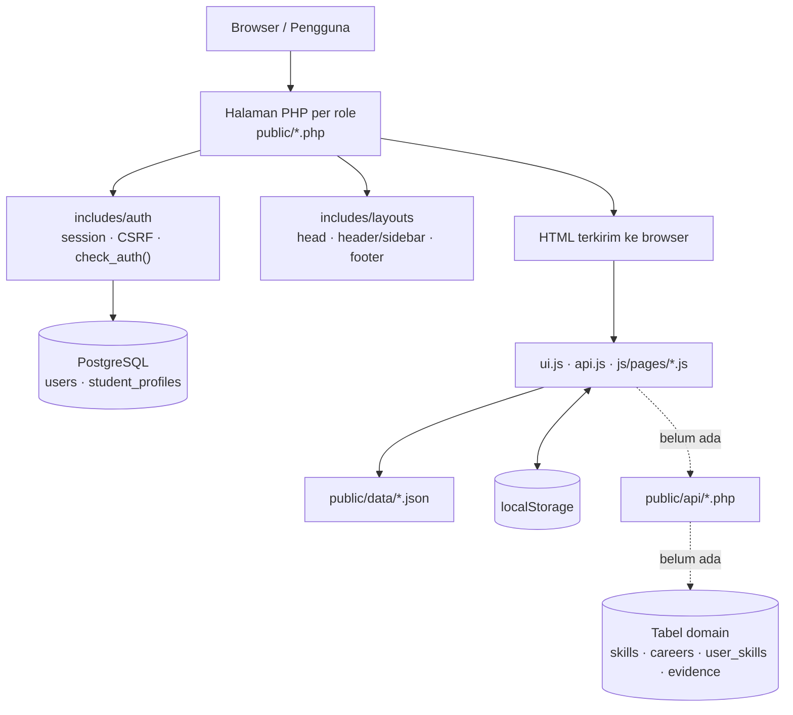
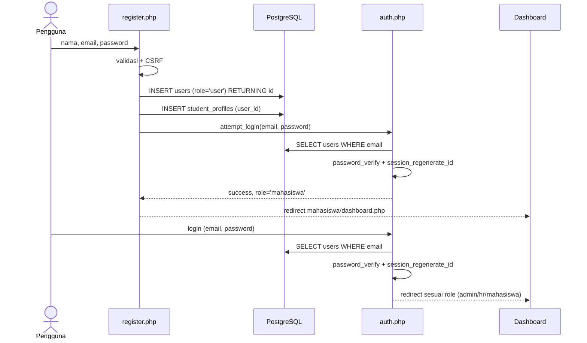
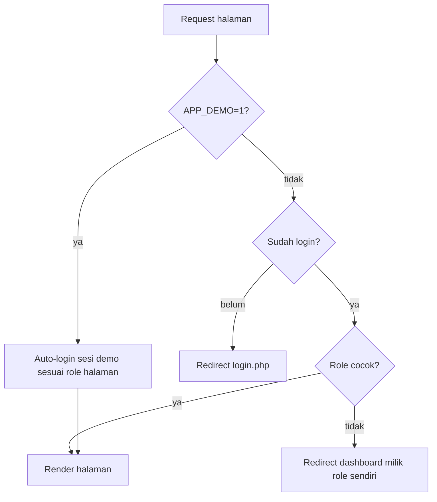
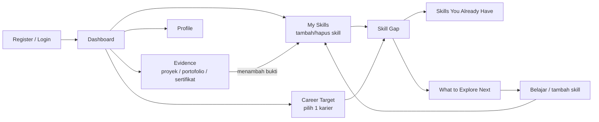
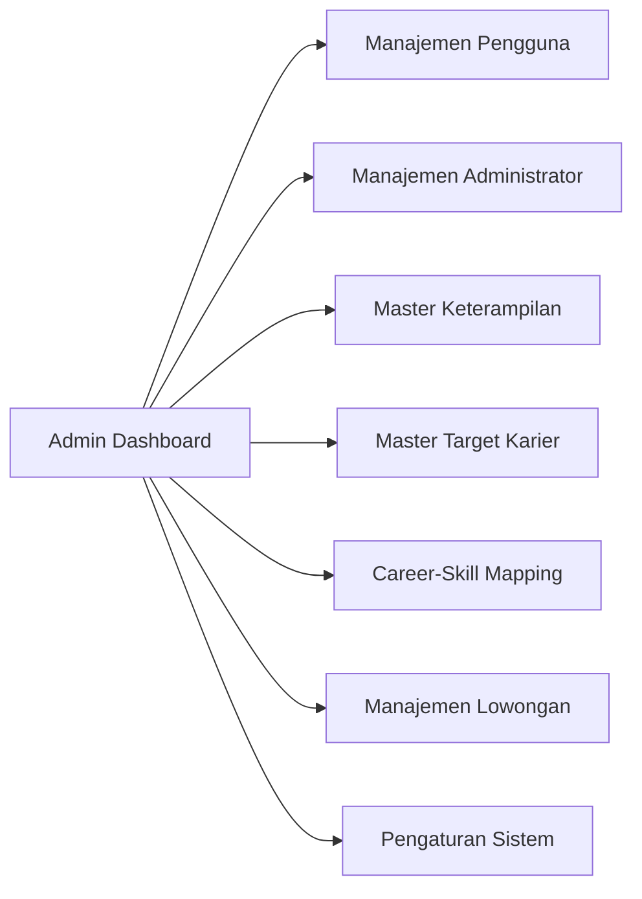
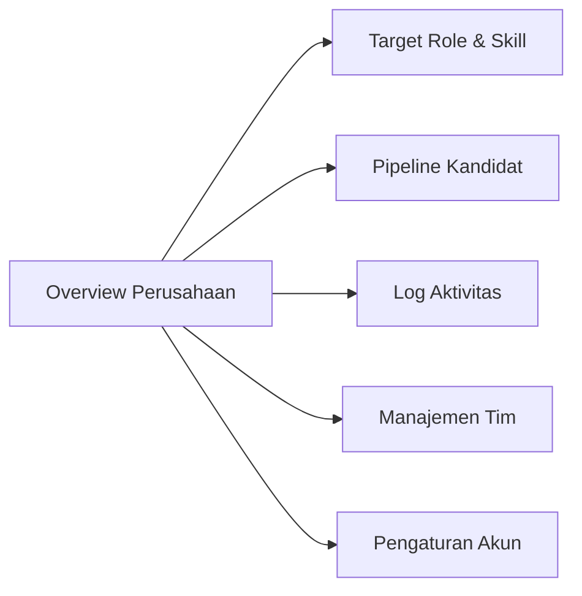
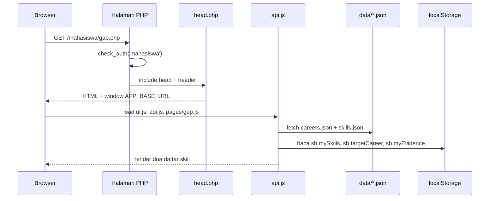
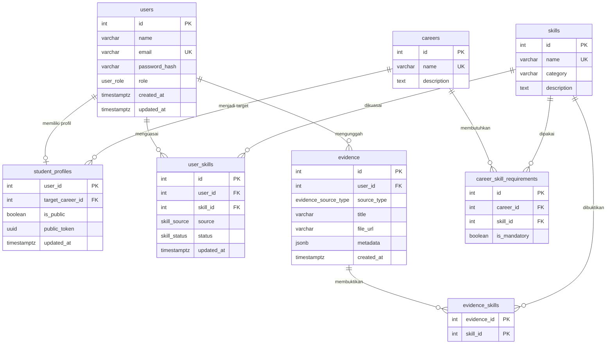

> **Catatan sinkronisasi 2026-10-24:** Role dan modul HR telah dihapus total dari aplikasi dan database. Fitur pengganti adalah pencarian profil publik (navbar mahasiswa/header admin) dan halaman profil publik berbasis token. Narasi historis di bawah dipertahankan sebagai catatan proses, bukan keadaan kode saat ini.

# Pemetaan Project SkillBridge

| Item | Keterangan |
| --- | --- |
| **Dokumen** | Pemetaan project: produk, arsitektur, alur, data, status implementasi, dan gap analysis |
| **Produk** | SkillBridge — platform pemetaan skill dan skill gap terhadap target karier |
| **Repo** | `HaikalMaghsin/SkillBridge` |
| **Disusun** | 23 Oktober 2026 |
| **Cakupan** | Seluruh role yang ada di kode: mahasiswa, HR, dan admin |
| **Sumber bukti** | Kode di `includes/`, `public/`, `db/`, `tools/`; dokumen `Laporan/LaporanPBL.md`, `Laporan/Notion.md`, `docs/PRD.md` |
| **Sifat** | Deskriptif + gap analysis (selisih dokumen vs implementasi) |

> Dokumen ini memetakan **kondisi nyata kode**, bukan hanya rencana di proposal. Setiap temuan penting disertai path dan nomor baris agar bisa diverifikasi langsung. Path file ditulis relatif terhadap root repo; rute yang diawali `/` adalah URL aplikasi, bukan path file. Nama file yang disingkat (mis. `dashboard.js`) merujuk pada `public/js/pages/`.

---

## 1. Ringkasan Eksekutif

**SkillBridge** adalah aplikasi web untuk membantu mahasiswa dan *fresh graduate* membentuk profil keterampilan, memilih target karier, dan memahami *skill gap* — keterampilan apa yang sudah dimiliki dan apa yang perlu dikembangkan. Aplikasi dikembangkan sebagai proyek PjBL mata kuliah **Desain dan Pemrograman Web** di Politeknik Negeri Malang.

**Yang sudah berjalan hari ini:**

1. **Autentikasi nyata di PostgreSQL** — registrasi, login, logout, session, CSRF, dan guard per role (`includes/auth/`).
2. **Tiga konsol terpisah** — mahasiswa (6 halaman), HR (6 halaman), admin (8 halaman), plus landing page dan halaman auth. Seluruhnya memakai sistem layout modular di `includes/layouts/`.
3. **Fitur domain mahasiswa berjalan sebagai demo client-side** — My Skills, Career Target, dan Skill Gap menggunakan `public/data/*.json` + `localStorage`; belum ada backend domain.
4. **Skema database sudah didesain untuk fitur inti** — termasuk `user_skills` berstatus `candidate/confirmed` (untuk hasil ekstraksi CV), `evidence` + `evidence_skills`, dan view `v_skill_gap`.

**Temuan utama yang perlu diketahui sebelum menulis laporan:**

| # | Temuan | Ringkas |
| --- | --- | --- |
| 1 | **Fitur CV belum ada** | Upload/identifikasi/review CV adalah fitur inti di revisi proposal, tetapi `cv.php` dan `cv_review.php` tidak ada, begitu juga endpoint atau logika ekstraksi. |
| 2 | **Konsol HR di luar scope** | Kode memiliki 6 halaman HR, tetapi revisi proposal menyatakan rekrutmen/lowongan di luar ruang lingkup; skema DB tidak punya tabel HR. |
| 3 | **Data domain belum masuk database** | `public/api/` tidak ada. Semua data skill, evidence, target karier, gap, HR, dan admin dibaca dari JSON + `localStorage` lewat `public/js/api.js`. |
| 4 | **Satu fitur rusak** | Simpan Evidence memanggil `API.createEvidence` yang tidak ada (`public/js/pages/evidence.js:171`), sehingga melempar `TypeError`. |
| 5 | **Bug layout di konsol admin** | Navbar mahasiswa ikut ter-render di halaman admin karena `body[data-nav]` ditafsirkan `ui.js` sebagai penanda navbar mahasiswa. |

---

## 2. Tentang Project

### 2.1 Identitas

| Item | Detail |
| --- | --- |
| **Nama produk** | SkillBridge |
| **Tagline** | Platform pemetaan skill dan skill gap terhadap target karier bagi mahasiswa dan fresh graduate |
| **Jenis** | Aplikasi web multi-role (PHP native + PostgreSQL) |
| **Konteks** | PjBL mata kuliah Desain dan Pemrograman Web, Jurusan Teknologi Informasi, Prodi D-IV Teknik Informatika, Politeknik Negeri Malang |
| **Dosen pengampu** | Dimas Wahyu Wibowo, S.T., M.T. (kelas TI-2D) |
| **Mata kuliah terintegrasi** | Desain dan Pemrograman Web; Sistem Informasi Manajemen; Basis Data Lanjut; Manajemen Proyek |
| **Repository** | `https://github.com/HaikalMaghsin/SkillBridge.git` |
| **Desain** | Figma: `https://www.figma.com/design/6kOcdww5M4gEObffBk12rp/SkillBridge` |

### 2.2 Tim

Versi di `Laporan/LaporanPBL.md`:

| Nama | NIM | Peran |
| --- | --- | --- |
| Haikal Maghsin | 254107020189 | Project Manager & System Analyst |
| Geraldi Rama Nugraha | 254107020100 | UI/UX Designer |
| M. Javier Thufail | 254107020019 | Frontend Developer |
| Marvelino Husca | 254107020184 | Backend Developer |

> **Catatan:** `Laporan/Notion.md` mencantumkan pembagian peran yang berbeda — Haikal (Ketua Tim & Pengembang Utama), Marvelino (Analis/Desainer), Javier (Sekretaris/Dokumentator), Geraldi (QA/Penguji). Perlu diselaraskan sebelum laporan dikumpulkan.

### 2.3 Masalah yang Diselesaikan

Mahasiswa dan *fresh graduate* umumnya sudah memiliki CV, tetapi informasi di dalamnya tidak otomatis membantu mereka memahami:

- keterampilan apa yang sebenarnya sudah mereka miliki;
- keterampilan apa yang masih kurang untuk karier yang dituju;
- langkah belajar apa yang masuk akal berikutnya.

SkillBridge menjawabnya dengan tiga hal: **profil keterampilan**, **target karier**, dan **perbandingan keduanya (skill gap)** yang disajikan deskriptif — tanpa skor atau persentase.

### 2.4 Ruang Lingkup

**Termasuk (sesuai revisi proposal):**

| Area | Deskripsi |
| --- | --- |
| Profil pengguna | Informasi dasar dan target karier yang dipilih |
| Upload CV | CV sebagai sumber awal identifikasi keterampilan |
| Identifikasi skill dari CV | Menghasilkan kandidat skill, bukan data final |
| Review hasil identifikasi | Tinjau, perbaiki, tambah, hapus, konfirmasi sebelum disimpan |
| Pengelolaan keterampilan | Lihat, tambah, hapus skill milik pengguna |
| Target karier | Memilih dari daftar karier yang tersedia |
| Pemetaan karier–skill | Relasi kebutuhan skill per target karier |
| Skill gap | Dua daftar: sudah dimiliki vs perlu dikembangkan |
| Evidence | Bukti pendukung sederhana (proyek, portofolio, sertifikat) |
| Administrasi | Admin mengelola skill, karier, relasi karier–skill, dan data pengguna |

**Tidak termasuk:**

- Rekrutmen, lowongan, lamaran, pipeline kandidat, wawancara, dan keputusan penerimaan.
- Skor kesiapan karier, persentase kecocokan, peringkat, atau penilaian tingkat penguasaan.
- Analisis repositori GitHub, analisis source code, dan verifikasi otomatis evidence.
- Klaim bahwa pemetaan skill adalah standar universal industri.

### 2.5 Pemangku Kepentingan

| Pemangku kepentingan | Kepentingan |
| --- | --- |
| Mahasiswa / fresh graduate | Pengguna utama: profil, CV, target karier, evidence, skill gap |
| Administrator | Mengelola master data: skill, karier, mapping, pengguna |
| Tim pengembang | Analisis, perancangan, implementasi, pengujian, dokumentasi |
| Dosen pembimbing | Arahan, evaluasi ruang lingkup, dan hasil proyek |
| Praktisi / mentor / software engineer | Masukan relevansi skill dan evaluasi rancangan |

---

## 3. Arsitektur & Teknologi

### 3.1 Stack

| Lapisan | Teknologi | Catatan |
| --- | --- | --- |
| Backend | PHP 8.x native | Tanpa framework; entry per halaman, bukan front controller |
| Database | PostgreSQL (Supabase) via `PDO_PGSQL` | Dipakai **hanya** untuk auth saat ini |
| Frontend | HTML5, CSS3 native, Vanilla JS (ES6+) | Tanpa bundler, tanpa framework |
| Font/ikon | Google Fonts Inter; SVG inline / `public/assets/icons` | Tanpa CDN ikon eksternal |
| Web server | Apache (Docker) atau `php -S` | Document root wajib `public/` |
| Container | `php:8.3-apache` | `Dockerfile` + `docker/entrypoint.sh` |

### 3.2 Peta Direktori

```text
PBL/
├── includes/
│   ├── config/
│   │   ├── app.php              # BASE_URL, base_url(), asset(), e()
│   │   └── database.php         # env loader + get_db_connection() (PDO pgsql)
│   ├── auth/
│   │   ├── session.php          # session aman (HttpOnly, SameSite=Lax)
│   │   ├── csrf.php             # token + validasi
│   │   ├── auth.php             # login, logout, guard check_auth(), demo mode
│   │   └── middleware.php       # require_login()/require_role() (tidak dipakai halaman)
│   └── layouts/
│       ├── head.php             # <head>, CSS per role, meta CSRF, APP_BASE_URL
│       ├── scripts.php          # loader script global (tidak dipakai)
│       ├── public_header.php / public_footer.php
│       ├── mahasiswa_header.php / mahasiswa_footer.php
│       ├── hr_header.php / hr_sidebar.php / hr_footer.php
│       └── admin_header.php / admin_sidebar.php / admin_footer.php
├── public/                      # document root
│   ├── index.php                # landing page
│   ├── login.php / register.php / logout.php
│   ├── mahasiswa/               # dashboard, skills, evidence, career, gap, profile
│   ├── hr/                      # index, roles, candidates, activity, team, settings
│   ├── admin/                   # index, users, admins, skills, careers, mapping, vacancies, settings
│   ├── css/                     # style.css, recruiter.css, admin.css
│   ├── js/                      # ui.js, api.js, landing.js, admin-nav.js, pages/*.js
│   ├── data/                    # seed JSON untuk data domain (dummy)
│   └── assets/                  # icons/, landing/
├── db/
│   ├── schema.sql               # skema PostgreSQL (user/admin)
│   ├── seed.sql                 # 18 skills, 4 careers, 20 mapping
│   └── optional_hr_role.sql     # ALTER TYPE ... ADD VALUE 'hr'
├── tools/create_admin.php       # CLI pembuatan admin
├── docs/                        # PRD, aturan responsif, mockup desain
├── docker/entrypoint.sh
├── Dockerfile
├── .htaccess
└── index.php                    # redirect ke public/index.php
```

### 3.3 Arsitektur Dua Lapis

Inti arsitektur yang perlu dipahami: **auth di server, data domain di browser.**



- **Lapis A — PostgreSQL:** hanya `users` dan `student_profiles`. Query server-side hanya ada di login, registrasi, dan `tools/create_admin.php`.
- **Lapis B — JSON + localStorage:** seluruh data domain. `public/js/api.js` adalah satu-satunya pintu akses data untuk halaman; komentar di dalamnya sudah menyiapkan nama endpoint (`api/skills.php`, `api/evidence.php`, dst.), tetapi **direktori `public/api/` tidak ada**.
- **Konsekuensi:** data tidak terikat akun, tidak lintas perangkat, dan tidak lintas pengguna. Menghapus `localStorage` mengembalikan data ke seed JSON.

### 3.4 Sistem Layout

Setiap halaman hanya boleh berisi guard, variabel halaman, lalu `require_once` layout. Variabel yang **benar-benar dipakai**:

| Variabel | Fungsi | Dipakai di |
| --- | --- | --- |
| `$page_title` | Judul `<title>` | `includes/layouts/head.php:19` |
| `$role` | Memilih CSS role (`style.css` + recruiter/admin) | `includes/layouts/head.php:29-33` |
| `$body_class` | Class `<body>` | Landing, HR, admin |
| `$body_attrs` | Atribut mentah `<body>` (`data-nav`, `data-rec-page`, `data-admin-page`) | Semua role |
| `$nav_active` | Menu aktif mahasiswa/public | `mahasiswa_header.php`, `public_header.php` |
| `$rec_page` | Menu aktif HR | `hr_sidebar.php` |
| `$admin_page` | Menu aktif admin | `admin_sidebar.php` |
| `$page_script` | Nama file `js/pages/*.js` | `hr_footer.php:16`, `admin_footer.php:17` |

Variabel/komponen yang **didokumentasikan tetapi mati**:

| Item | Status |
| --- | --- |
| `includes/layouts/scripts.php` | Tidak pernah di-`require` halaman mana pun |
| `$page_js` | Hanya dibaca `scripts.php`, yang tidak dipakai |
| `$role_css` | Tidak pernah didefinisikan/dibaca; `head.php` memilih CSS langsung dari `$role` |
| `$path_prefix` | Selalu di-set halaman, tetapi diabaikan `redirect_to_dashboard()` |
| `includes/auth/middleware.php` | `require_login()`/`require_role()` ada, tetapi semua halaman memakai `check_auth()` |

> Dua konvensi script hidup berdampingan: halaman mahasiswa menulis `<script>` manual di akhir file, sedangkan HR/admin memakai `$page_script` melalui footer.

---

## 4. Aktor, Role, dan Autentikasi

### 4.1 Pemetaan Role

| Role di database (`user_role`) | Role di aplikasi | Folder | Redirect setelah login |
| --- | --- | --- | --- |
| `user` | `mahasiswa` | `public/mahasiswa/` | `mahasiswa/dashboard.php` |
| `admin` | `admin` | `public/admin/` | `admin/index.php` |
| `hr` (opsional) | `hr` | `public/hr/` | `hr/index.php` |

- Pemetaan dilakukan `db_role_to_app_role()` / `app_role_to_db_role()` (`includes/auth/auth.php:19-25`).
- Role `hr` hanya bisa ada jika `db/optional_hr_role.sql` dijalankan. Tidak ada tool pembuatan akun HR, dan tidak ada tabel khusus HR.
- Registrasi publik selalu membuat role `user` (mahasiswa).

### 4.2 Alur Registrasi & Login



Detail penting:

- Password disimpan dengan `password_hash()` (`public/register.php:39-55`) dan diverifikasi `password_verify()` (`includes/auth/auth.php:118-173`).
- Saat email tidak ditemukan, verifikasi tetap dijalankan terhadap hash dummy agar waktu respons tidak membocorkan keberadaan email.
- Session menyimpan `id`, `name`, `email`, `role`, `role_label`, `initials`.
- Logout mengosongkan `$_SESSION`, menghapus cookie, `session_destroy()`, lalu redirect ke login (`includes/auth/auth.php:190-200`).

### 4.3 Guard Halaman



- Setiap halaman memanggil `check_auth('<role>')` di baris awal.
- `APP_DEMO=1` membuat proteksi role efektif **bypass**: membuka URL role apa pun akan membuat sesi demo role tersebut, dan berpindah role akan menimpa sesi (`includes/auth/auth.php:66-88`). Ini hanya untuk pengujian UI dan **berisiko bila aktif di produksi**.
- Tidak ada halaman error 403; role yang salah selalu dilempar ke dashboard miliknya.

### 4.4 Keamanan yang Sudah Diterapkan

| Aspek | Implementasi |
| --- | --- |
| XSS | `e()` = `htmlspecialchars(..., ENT_QUOTES, 'UTF-8')` untuk output PHP; JS merender dengan `textContent`/`createElement` |
| CSRF | Token 32 byte, `<meta name="csrf-token">`, hidden input di form, validasi `hash_equals`, dukung header `X-CSRF-Token` |
| SQL Injection | PDO prepared statements di seluruh query server-side |
| Session | `HttpOnly`, `SameSite=Lax`, `secure` saat HTTPS, regenerasi ID setelah login |
| Password | `password_hash()` / `password_verify()` (bcrypt) |

**Catatan:** `$body_attrs` dan `$extra_head` di `head.php` sengaja di-output mentah; aman hanya karena nilainya berasal dari kode halaman, bukan input pengguna.

### 4.5 Akun Demo (`APP_DEMO=1`, tanpa database)

| Email | Password | Role |
| --- | --- | --- |
| `admin@skillbridge.id` | `password123` | admin |
| `hr@techindonesia.com` | `password123` | hr |
| `jhondoe@gmail.com` | `password123` | mahasiswa |
| `mahasiswa@skillbridge.id` | `password123` | mahasiswa |

Jika database tersedia tetapi email tidak ditemukan, fallback demo **tidak** dipakai.

---

## 5. Alur Utama (User Flow)

### 5.1 Alur Publik

`index.php` (landing) → `login.php` atau `register.php` → redirect ke dashboard sesuai role. `logout.php` menghapus sesi dan kembali ke login.

Landing page bersifat statis (marketing), dengan pencarian yang mengarah ke `mahasiswa/skills.php#q=...` — tetapi tidak ada halaman yang membaca parameter `#q`, sehingga hasil pencarian dibuang.

### 5.2 Alur Mahasiswa



Narasi per halaman:

1. **Dashboard** — ringkasan target karier, jumlah skill, evidence terbaru, dan skill gap. Data diambil dari `localStorage`; beberapa teks masih statis (mis. "Semester 3 focus", "Five of your skills are already strong…").
2. **My Skills** — katalog 18 skill bawaan + skill buatan pengguna. Menambah/menghapus skill mengubah `sb.mySkills`. Setiap skill diberi label **Strong** jika punya ≥ 2 evidence, selain itu **Growing**.
3. **Evidence** — modal tambah evidence dengan judul, tipe, URL, deskripsi, dan skill terkait. **Saat ini rusak** (lihat Gap G5).
4. **Career Target** — 4 karier (Backend Developer, Frontend Developer, Data Analyst, UI/UX Designer), masing-masing 5 skill. Tombol **Set as Target** menyimpan `sb.targetCareer`.
5. **Skill Gap** — membandingkan skill target karier dengan skill yang dimiliki:
   - `have` = required skill ∩ skill milik pengguna;
   - `explore` = required skill − skill milik pengguna;
   - tidak ada skor atau persentase.
6. **Profile** — data profil dummy yang disimpan ke `sb.profile`; ubah password dan foto belum tersambung ke backend.

### 5.3 Alur Admin



Status nyata: dashboard memakai angka hardcoded; halaman skills/careers/mapping read-only; users/admins/vacancies hanya mengubah status atau menghapus di `localStorage`; tambah/edit berupa toast tanpa efek; settings hanya menyimpan konfigurasi di browser.

### 5.4 Alur HR (Demo, di Luar Scope Revisi)



Seluruh data HR berasal dari `public/data/recruiter-*.json` dan `localStorage`. Tidak ada tabel perusahaan, tim, kandidat, atau lowongan di database. Konsol ini adalah sisa dari PRD versi 3 role dan tidak termasuk ruang lingkup revisi proposal.

### 5.5 Siklus Data Runtime (Satu Halaman)



`api.js` menormalkan URL lewat `resolveUrl()` (`public/js/api.js:15-22`), lalu memakai `window.APP_BASE_URL` yang di-set `head.php`. Semua `fetch()` hanya menuju JSON; tidak ada satu pun yang menuju PHP.

### 5.6 Logika Skill Gap

**Di UI (demo):** `getSkillGap()` (`public/js/api.js:113-131`) mengambil karier target, mencocokkan nama skill karier ke katalog, lalu membagi hasil menjadi `have` dan `explore`. Jumlah evidence per skill dihitung dari `sb.myEvidence`.

**Di database (belum dipakai UI):** view `v_skill_gap` (`db/schema.sql:128-142`) menghasilkan satu baris per skill yang dibutuhkan target karier, dengan `has_skill = TRUE` jika user punya skill berstatus `confirmed`. View ini sudah siap dipakai backend, tetapi belum ada endpoint yang memakainya.

---

## 6. Inventaris Halaman & Status Implementasi

Legenda status: **Fungsional (demo)** = interaksi berjalan tetapi data di browser; **Read-only** = hanya menampilkan; **Rusak** = aksi gagal; **Statis** = konten hardcoded.

### 6.1 Publik & Auth

| File | Fungsi | Sumber data | Status | Catatan |
| --- | --- | --- | --- | --- |
| `public/index.php` | Landing page | Statis + `landing.js` | Statis | Pencarian `#q` tidak dibaca |
| `public/login.php` | Login multi-role | PostgreSQL / demo | Fungsional | Dukung POST form & JSON |
| `public/register.php` | Registrasi mahasiswa | PostgreSQL | Fungsional | Validasi server-side + auto-login |
| `public/logout.php` | Handler logout | Session | Fungsional | — |

### 6.2 Mahasiswa

| File | Fungsi | Sumber data | Status | Catatan |
| --- | --- | --- | --- | --- |
| `mahasiswa/dashboard.php` | Ringkasan profil & gap | JSON + localStorage | Fungsional (demo) | Beberapa teks statis |
| `mahasiswa/skills.php` | Daftar & tambah skill | JSON + localStorage | Fungsional (demo) | `API.removeSkill` ada tetapi tidak terpasang di UI |
| `mahasiswa/evidence.php` | Daftar & tambah evidence | localStorage | **Rusak** | Memanggil `API.createEvidence` yang tidak ada; chip skill statis |
| `mahasiswa/career.php` | Pilih target karier | JSON + localStorage | Fungsional (demo) | — |
| `mahasiswa/gap.php` | Dua daftar skill gap | JSON + localStorage | Read-only | Teks "Once you add Express.js…" hardcoded |
| `mahasiswa/profile.php` | Profil & pengaturan akun | localStorage | Dummy | Password/foto tanpa backend |

### 6.3 HR (di luar scope revisi)

| File | Fungsi | Sumber data | Status | Catatan |
| --- | --- | --- | --- | --- |
| `hr/index.php` | Overview perusahaan | JSON recruiter | Read-only | Tombol tambah recruiter → `team.php#invite` |
| `hr/roles.php` | Target role & mapping skill | JSON + localStorage | Fungsional (demo) | Mapping per role disimpan di `sb.rec.mapping.<id>` |
| `hr/candidates.php` | Pipeline kandidat | JSON recruiter | Read-only | Aksi hanya toast |
| `hr/activity.php` | Log aktivitas | JSON recruiter | Read-only | Filter pencarian di client |
| `hr/team.php` | Manajemen tim | JSON + localStorage | Fungsional (demo) | Undang anggota hanya toast |
| `hr/settings.php` | Pengaturan akun | localStorage | Dummy | Tab email/keamanan/API placeholder |

### 6.4 Admin

| File | Fungsi | Sumber data | Status | Catatan |
| --- | --- | --- | --- | --- |
| `admin/index.php` | Dashboard metrik | Statis | Statis | Angka hardcoded; hasil `getAdminStats()` tidak dipakai |
| `admin/users.php` | Manajemen pengguna | JSON admin | Fungsional (demo) | Hapus persist; tambah/edit toast |
| `admin/admins.php` | Manajemen admin | JSON admin | Fungsional (demo) | Status/hapus persist |
| `admin/skills.php` | Master skill | JSON skills | Read-only | CRUD hanya toast |
| `admin/careers.php` | Master karier | JSON careers | Read-only | CRUD hanya toast |
| `admin/mapping.php` | Mapping karier–skill | Turunan JSON | Read-only | CRUD hanya toast |
| `admin/vacancies.php` | Manajemen lowongan | JSON admin | Fungsional (demo) | Status/hapus persist |
| `admin/settings.php` | Pengaturan sistem | localStorage | Dummy | Menyimpan `sb.admin.profile` & `sb.admin.config` |

---

## 7. Model Data

### 7.1 ERD (sesuai `db/schema.sql`)



### 7.2 Enum dan Objek Penting

| Objek | Nilai / Fungsi |
| --- | --- |
| `user_role` | `user`, `admin` (+ `hr` via migrasi opsional) |
| `evidence_source_type` | `cv`, `project`, `portfolio`, `certificate` |
| `skill_source` | `manual`, `cv_extracted` |
| `skill_status` | `candidate`, `confirmed` |
| `set_updated_at()` | Trigger `updated_at` pada `users`, `student_profiles`, `user_skills` |
| `v_skill_gap` | View deskriptif: satu baris per skill target karier + `has_skill` |

**Desain yang sudah mendukung fitur CV:** hasil ekstraksi masuk sebagai `user_skills` dengan `source='cv_extracted'` dan `status='candidate'`, lalu dikonfirmasi pengguna menjadi `confirmed`. Belum ada kode yang menulis alur ini.

### 7.3 Seed Data

`db/seed.sql` (idempoten, `ON CONFLICT DO NOTHING`):

- **18 skill** dalam kategori Programming, Database, Web, Tools, Data, Design.
- **4 karier**: Backend Developer, Frontend Developer, Data Analyst, UI/UX Designer.
- **20 relasi** career–skill (5 skill per karier).
- Tidak ada seed user, profil, evidence, atau admin.

### 7.4 Dua Lapis Penyimpanan

**PostgreSQL:** `users`, `student_profiles` (auth + baris profil kosong).

**JSON seed:**

| File | Isi | Dibaca oleh |
| --- | --- | --- |
| `public/data/skills.json` | 18 skill | `getSkillCatalog`, `getMasterSkills` |
| `public/data/careers.json` | 4 karier + skill | `getCareers` |
| `public/data/evidence.json` | 3 evidence | **Tidak pernah dibaca** (orphan) |
| `public/data/admin-users.json` | 10 pengguna | `getAdminUsers` |
| `public/data/admin-jobs.json` | 4 admin | `getJobAdmins` |
| `public/data/admin-vacancies.json` | 6 lowongan | `getVacancies` |
| `public/data/admin-content.json` | 5 konten | `getAdminContent` (hanya statistik) |
| `public/data/recruiter-*.json` | company, team, roles, activity, candidates | Konsol HR |

**localStorage:**

| Key | Isi |
| --- | --- |
| `sb.mySkills` | Array ID skill milik pengguna |
| `sb.myEvidence` | Array evidence |
| `sb.targetCareer` | ID karier target |
| `sb.customSkills` | Skill buatan pengguna |
| `sb.profile` / `sb.portfolioVisibility` | Profil mahasiswa |
| `sb.admin.users` / `.jobs` / `.vacancies` / `.content` | Cache & hasil edit data admin |
| `sb.admin.profile` / `sb.admin.config` | Pengaturan admin |
| `sb.rec.company` / `.team` / `.roles` / `.activity` / `.candidates` | Cache & hasil edit data HR |
| `sb.rec.company.edit` | Edit profil perusahaan (tidak pernah dibaca kembali) |
| `sb.rec.mapping.<roleId>` | Mapping skill per target role HR |

### 7.5 Ketidakcocokan Skema vs UI

| Hal | Skema DB | UI/Kode |
| --- | --- | --- |
| Tipe evidence | `cv`, `project`, `portfolio`, `certificate` | Form menawarkan `cv`, `github`, `portfolio`, `project`, `certificate`, `assessment` |
| Deskripsi evidence | Hanya `metadata JSONB` | Payload mengirim `description` dan `metadata.skills` |
| Skill evidence | Tabel `evidence_skills` (many-to-many) | Payload mengirim `skill_ids` (tidak pernah sampai ke DB) |
| HR | Tidak ada tabel | 6 halaman + 5 JSON seed |
| Lowongan | Tidak ada tabel | Halaman admin vacancies + JSON |
| Profil publik | `is_public`, `public_token` | Tidak ada UI/endpoint |

---

## 8. Deployment & Menjalankan Lokal

### 8.1 Lokal

```bash
# 1. Database
createdb skillbridge
psql skillbridge -f db/schema.sql
psql skillbridge -f db/seed.sql

# 2. Environment
cp .env.example .env
# sesuaikan DB_HOST, DB_PORT, DB_NAME, DB_USER, DB_PASS, DB_SSLMODE

# 3. Admin (password diminta interaktif, atau set ADMIN_PASSWORD)
php tools/create_admin.php admin@contoh.id "Nama Admin"

# 4. Server (document root = public/)
php -S localhost:8000 -t public

# Opsional: mode demo tanpa database (JANGAN di produksi)
APP_DEMO=1 php -S localhost:8000 -t public
```

### 8.2 Docker

- Base image `php:8.3-apache`, ekstensi `pdo_pgsql` dikompilasi.
- Kode disalin ke `/var/www/app`; document root diarahkan ke `/var/www/app/public`.
- `docker/entrypoint.sh` menyesuaikan port Apache dari env `PORT` (default 80).
- `AllowOverride None` membuat `.htaccess` tidak dipakai di Docker — aman karena document root sudah `public/`.

### 8.3 Catatan Konfigurasi

- `.htaccess` hanya relevan bila root repo dijadikan document root; ia memblokir akses ke `includes/`, `db/`, `tools/`, `docker/`, `docs/`, dan file `.sql`/`.md`/`.env`, tetapi tidak me-rewrite URL root ke `public/`.
- Supabase: gunakan **Session pooler** (port 5432, IPv4). Untuk transaction pooler (6543), set `DB_EMULATE_PREPARES=1`.
- `README.md` ber-encoding **UTF-16LE**, sehingga bisa tampil aneh di terminal/editor tertentu; untuk membaca: `iconv -f UTF-16LE -t UTF-8 README.md`.
- `tools/create_admin.php` hanya bisa dijalankan via CLI dan melakukan upsert admin berdasarkan email.

---

## 9. Gap Analysis: Dokumen vs Implementasi

### 9.1 Gap Produk & Fitur

| ID | Area | Klaim dokumen | Kondisi kode | Bukti | Dampak | Rekomendasi |
| --- | --- | --- | --- | --- | --- | --- |
| **G1** | Upload & review CV | Fitur inti + kriteria keberhasilan No. 2–4 (`LaporanPBL.md`; `docs/PRD.md:68`) | Tidak ada halaman, endpoint, unggah file, ekstraksi, atau review | `public/mahasiswa/` hanya 6 file; tidak ada `cv.php`/`cv_review.php` | Fitur pembeda utama belum bisa didemokan; laporan tidak sesuai implementasi | Implementasikan CV upload + ekstraksi kata kunci + review sebelum simpan, atau turunkan klaim di laporan |
| **G2** | Konsol HR | PRD & `CLAUDE.md` mendefinisikan 3 role; revisi proposal menyatakan rekrutmen di luar scope | 6 halaman HR + 5 JSON seed; tanpa tabel/akun HR | `public/hr/*.php`; `db/schema.sql:10`; `db/optional_hr_role.sql` | Ambiguitas ruang lingkup; effort HR tidak diakui di laporan | Putuskan: keluarkan HR dari produk (hapus/arsipkan) atau masukkan kembali ke scope dan lengkapi backend |
| **G3** | Data domain | PRD menyiratkan backend DB; komentar `api.js` menyebut endpoint `public/api/*.php` | Semua domain JSON + localStorage; `public/api/` tidak ada | `public/js/api.js:3-5, 26-319`; `ls public/api` gagal | Data tidak lintas pengguna/perangkat; tidak ada otoritas server; tidak siap multi-user | Bangun `public/api/*.php` + query ke tabel domain, lalu ganti isi `api.js` |
| **G4** | CRUD master data admin | Admin mengelola skill, karier, mapping, pengguna | Skills/careers/mapping read-only; tambah/edit toast; hapus/status hanya localStorage | `public/js/pages/admin-skills.js`, `admin-careers.js`, `admin-mapping.js` | Admin tidak benar-benar bisa mengelola data | Sambungkan ke endpoint + tabel `skills`, `careers`, `career_skill_requirements` |
| **G5** | Simpan Evidence | Evidence CRUD berfungsi | Memanggil `API.createEvidence` yang tidak diekspor; seed `evidence.json` tidak dipakai; daftar awal kosong | `public/js/pages/evidence.js:171`; `public/js/api.js:98, 367`; `public/js/api.js:336-339` | Tombol simpan melempar `TypeError`; fitur evidence tidak bisa dipakai | Ganti ke `API.addEvidence` atau tambahkan alias; putuskan seed evidence |
| **G6** | Navbar admin | Admin memakai layout admin | `data-nav` di body admin memicu `renderNavbar()` mahasiswa; halaman admin tidak punya `header.navbar` | `public/js/ui.js:122-171`; `public/admin/*.php:12` | Navbar mahasiswa ("Jhon Doe") muncul di setiap halaman admin, link menyesatkan | Hapus `data-nav` dari halaman admin atau batasi `renderNavbar()` ke `$role === 'mahasiswa'` |
| **G7** | Dashboard admin | Menampilkan metrik platform | Angka kartu hardcoded; `getAdminStats()` dipanggil tetapi hasilnya tidak dipakai | `public/js/pages/admin.js:9-25` | Metrik tidak mencerminkan data | Render dari `getAdminStats()` (lalu dari backend) |
| **G8** | Profil & akun | Kelola profil, ubah password, profil publik | Profil hanya `sb.profile`; password/foto tanpa backend; `is_public`/`public_token` tidak dipakai | `public/js/pages/profile.js:6-35`; `db/schema.sql:65-73` | Perubahan tidak persisten lintas perangkat; fitur publik tidak ada | Implementasikan endpoint profil; atau tandai eksplisit sebagai prototipe di laporan |
| **G9** | Label Strong/Growing | Revisi proposal: tidak menilai tingkat penguasaan | Skill diberi label **Strong** (≥2 evidence) / **Growing** | `public/js/api.js:66-73` | Label adalah bentuk penilaian tidak langsung yang berpotensi bertentangan dengan batasan laporan | Ganti dengan informasi netral ("2 evidence") atau jelaskan sebagai indikator kelengkapan portofolio |

### 9.2 Gap Teknis & Dokumentasi

| ID | Area | Temuan | Bukti | Dampak | Rekomendasi |
| --- | --- | --- | --- | --- | --- |
| **G10** | Struktur role DB | Aplikasi 3 role, DB hanya `user`/`admin`; HR butuh migrasi manual | `db/schema.sql:2-10`; `db/optional_hr_role.sql` | Login HR via DB tidak bisa tanpa intervensi manual | Selaraskan enum & dokumentasi, atau hapus HR dari kode |
| **G11** | Peran tim | `Notion.md` dan `LaporanPBL.md` berbeda untuk keempat anggota | `Laporan/Notion.md:10-19`; `LaporanPBL.md:23-30, 325-337` | Laporan tidak konsisten | Tetapkan satu versi dan perbarui keduanya |
| **G12** | Konvensi layout mati | `scripts.php` tidak dipakai; `$page_js`/`$role_css` tidak berfungsi; `$path_prefix` diabaikan | `includes/layouts/scripts.php:8-17`; `includes/auth/auth.php:175-188` | Dua cara memuat script; mudah salah saat menambah halaman | Satukan ke `scripts.php` atau hapus; perbarui `CLAUDE.md` |
| **G13** | Dokumentasi usang | Instruksi `dashboard.html`; pencarian `#q` tidak dibaca; perilaku "tanpa target" tidak konsisten; README UTF-16 | `public/js/api.js:5`; `public/js/landing.js:17`; `dashboard.js:14`, `gap.js:24-26`; `README.md` | Onboarding dan demo membingungkan | Bersihkan komentar, samakan fallback, konversi README ke UTF-8 |
| **G14** | Kesiapan laporan | `LaporanPBL.md` masih "Revisi Proposal"; Bab 8 & 9 kosong; subbab 6.2 tanpa gambar; belum ada bab implementasi/pengujian | `Laporan/LaporanPBL.md` bagian 8-9; gambar hanya sampul & ERD | Laporan belum memenuhi struktur laporan akhir | Lengkapi bab implementasi, pengujian, hasil, dan lampiran; sisipkan mockup `docs/design/*.jpg` |
| **G15** | Status di Notion | Roadmap masih "Belum mulai" untuk sebagian besar fase | `Laporan/Notion.md:93-100` | Bertentangan dengan kode yang sudah berjalan | Perbarui status roadmap |

---

## 10. Risiko & Prioritas Perbaikan

| Prioritas | Item | Alasan |
| --- | --- | --- |
| **P0 — menghambat demo** | Perbaiki `API.createEvidence` (G5) | Fitur evidence tidak bisa dipakai sama sekali |
| **P0** | Hentikan navbar mahasiswa di halaman admin (G6) | Tampilan admin terlihat rusak dan link menyesatkan |
| **P0** | Tetapkan mode demo: dummy vs backend (G3) | Menentukan apakah demo cukup di satu browser atau harus multi-user |
| **P1 — kesesuaian laporan** | Implementasi CV upload + review (G1) atau revisi klaim | Fitur inti yang dijanjikan proposal |
| **P1** | Sambungkan admin CRUD ke DB (G4) | Admin adalah pengelola master data; saat ini tidak fungsional |
| **P1** | Selesaikan keputusan scope HR (G2, G10) | Menghindari effort dan klaim yang tidak sinkron |
| **P1** | Perbaiki metrik dashboard admin (G7) | Angka hardcoded menyesatkan saat demo |
| **P2 — kebersihan** | Selaraskan label Strong/Growing (G9) | Konsistensi dengan batasan "tanpa penilaian tingkat penguasaan" |
| **P2** | Bersihkan konvensi mati & dokumentasi (G11–G15) | Mengurangi kebingungan tim dan penguji |
| **P2** | Tambahkan dukungan profil publik (G8) atau hapus dari skema | Menghindari fitur "hantu" di database |

---

## 11. Peta Dokumentasi yang Ada

| File | Isi | Status / Catatan |
| --- | --- | --- |
| `Laporan/LaporanPBL.md` | **Revisi Proposal**, 9 bab: sampul, ringkasan eksekutif, latar belakang & rumusan masalah, tujuan & ruang lingkup, deskripsi produk, rancangan teknis awal, rencana kerja & organisasi tim, rencana mitra industri, lampiran; daftar pustaka | Bab 8 dan 9 kosong; subbab 6.2 tanpa gambar; 2 gambar embedded base64 (sampul & ERD); belum ada bab implementasi/pengujian |
| `Laporan/Notion.md` | Ruang tim, peran, tautan Notion (problem statement, charter, WBS, use case, jadwal), scope MVP, roadmap, metrik keberhasilan | Status roadmap masih tahap perencanaan; peran tim berbeda dari laporan |
| `docs/PRD.md` | PRD versi 3 role (mahasiswa/HR/admin), spesifikasi halaman, skema DB, seed | Menjadi sumber `CLAUDE.md`; sebagian tidak sesuai revisi proposal |
| `docs/design/Dashboard.jpg`, `My-Skills.jpg`, `Skill-Gap.jpg`, `Career-Target.jpg`, `Evidence.jpg` | Mockup UI | Tidak ada mockup CV — konsisten dengan fitur CV yang belum dibuat |
| `docs/prd_responsive_dan_button.md` | Kebutuhan responsif & perilaku tombol | Acuan UI |
| `docs/ai_rules_responsive_dan_button.md` | Aturan implementasi responsif untuk AI | Acuan UI |
| `CLAUDE.md` | Guardrail arsitektur, batasan library, aturan layout/keamanan, urutan migrasi HTML → PHP | Sebagian variabel yang didokumentasikan sudah tidak dipakai |
| `README.md` | Setup lokal, role, deploy | Encoding UTF-16LE; instruksi `APP_DEMO` dan Supabase |

**Struktur laporan yang sudah ada vs yang dibutuhkan laporan akhir:** proposal sudah kuat di bagian masalah, scope, dan rencana; yang belum ada adalah bab **implementasi** (bukti fitur berjalan), **pengujian** (fungsional/usability), **hasil evaluasi**, dan **lampiran** (screenshot, daftar route, bukti pengujian).

---

## 12. Lampiran

### 12.1 Peta Route per Role

| Role | Route |
| --- | --- |
| Publik | `/index.php`, `/login.php`, `/register.php`, `/logout.php` |
| Mahasiswa | `/mahasiswa/dashboard.php`, `skills.php`, `evidence.php`, `career.php`, `gap.php`, `profile.php` |
| HR | `/hr/index.php`, `roles.php`, `candidates.php`, `activity.php`, `team.php`, `settings.php` |
| Admin | `/admin/index.php`, `users.php`, `admins.php`, `skills.php`, `careers.php`, `mapping.php`, `vacancies.php`, `settings.php` |
| Handler | `/logout.php`, `tools/create_admin.php` (CLI) |

### 12.2 Environment Variable

| Variabel | Default | Keterangan |
| --- | --- | --- |
| `APP_DEMO` | `0` | `1` = sesi demo otomatis tanpa DB (jangan di produksi) |
| `DB_HOST` | `127.0.0.1` | Host PostgreSQL |
| `DB_PORT` | `5432` | Port |
| `DB_NAME` | `postgres` | Nama database (contoh lokal: `skillbridge`) |
| `DB_USER` | `postgres` | User |
| `DB_PASS` | kosong | Password |
| `DB_SSLMODE` | `prefer` | Supabase: `require` |
| `DB_EMULATE_PREPARES` | mati | `1` untuk transaction pooler Supabase (port 6543) |
| `ADMIN_PASSWORD` | — | Opsional untuk `tools/create_admin.php` non-interaktif |

### 12.3 File Kunci

| Kebutuhan | File |
| --- | --- |
| Bootstrap & helper URL/escape | `includes/config/app.php` |
| Koneksi DB | `includes/config/database.php` |
| Auth & guard | `includes/auth/auth.php` |
| CSRF | `includes/auth/csrf.php` |
| Session | `includes/auth/session.php` |
| Layout | `includes/layouts/*.php` |
| Data domain (demo) | `public/js/api.js` + `public/data/*.json` |
| Skema & seed | `db/schema.sql`, `db/seed.sql` |
| Pembuatan admin | `tools/create_admin.php` |
| Deploy | `Dockerfile`, `docker/entrypoint.sh`, `.htaccess`, `.env.example` |

### 12.4 Glosarium

| Istilah | Arti di project ini |
| --- | --- |
| **Skill** | Keterampilan yang dimiliki pengguna atau dibutuhkan karier |
| **Target karier** | Satu karier yang dipilih pengguna sebagai acuan gap |
| **Skill gap** | Selisih antara skill yang dibutuhkan target karier dan skill yang dimiliki |
| **Evidence** | Bukti pendukung sederhana (proyek, portofolio, sertifikat, CV) — tidak diverifikasi sistem |
| **Master data** | Data yang dikelola admin: skill, karier, relasi karier–skill |
| **`candidate` / `confirmed`** | Status skill hasil ekstraksi CV sebelum/sesudah dikonfirmasi pengguna |
| **APP_DEMO** | Mode pengujian UI yang membuka sesi demo otomatis per role |

---

> **Kesimpulan satu paragraf:** SkillBridge sudah memiliki fondasi yang rapi — autentikasi database, layout modular per role, skema data yang matang, dan demo UI untuk hampir semua halaman. Yang belum ada adalah **jembatan antara UI dan database** (API domain), **fitur CV** yang menjadi pembeda utama di proposal, serta **konsistensi antara dokumen dan kode**. Untuk keperluan laporan, prioritaskan memperbaiki evidence dan navbar admin (P0), lalu putuskan apakah CV dan HR masuk atau keluar dari ruang lingkup sebelum bab implementasi ditulis.
